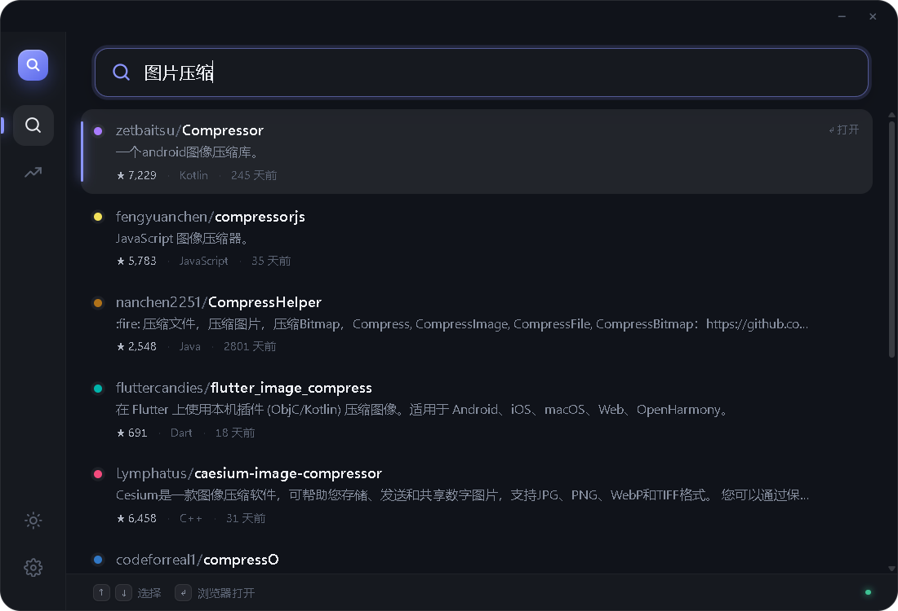
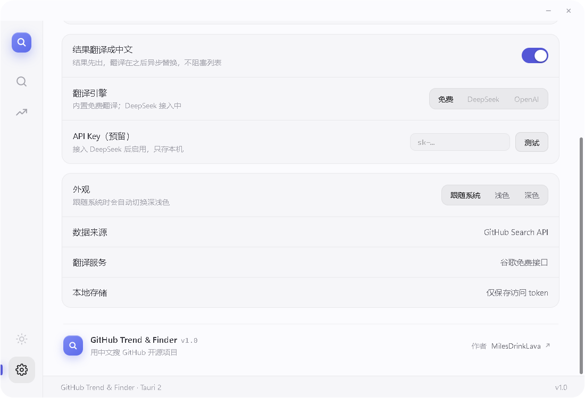

# GitHub Trend & Finder

当前开发版本：**V2.0 Alpha 2**（`2.0.0-alpha.2`，本地 `dev/v2.0` 分支，尚未公开发布）。稳定版 **V1.1** 与原版 **V1.0** 保留独立 Release。版本记录见 [CHANGELOG.md](CHANGELOG.md)。

V2 试用与边界：[中英文采样 + DeepSeek 筛选](docs/v2-alpha.md)。Skills 暂停。

## 版本选择

两个版本分别保留独立发布页、安装包和完整源码快照：

| 版本 | 独立发布页与安装包 | 完整源码 |
|---|---|---|
| **V1.1 · 审计与词库增强版**（当前） | [下载 V1.1](https://github.com/MilesDrinkLava/github-Trend-Finder/releases/tag/v1.1.0) | [v1.1.0 源码](https://github.com/MilesDrinkLava/github-Trend-Finder/tree/v1.1.0) |
| **V1.0 · 原始版** | [下载 V1.0](https://github.com/MilesDrinkLava/github-Trend-Finder/releases/tag/v1.0.0) | [v1.0.0 源码](https://github.com/MilesDrinkLava/github-Trend-Finder/tree/v1.0.0) |

V1.0 的原标签和原安装包保持不变。请按所需版本进入对应发布页下载；两版安装为同一应用的升级关系。

> 保留原生中文内容，扩展中英文检索表达，先用 GitHub 初筛，再用 DeepSeek 精读少量候选。



## 为什么做

GitHub 本来就有大量中文开发者及中文 README。V1 的单向词库翻译会漏掉原生中文内容，也无法充分表达真实需求。

V2 保留原文查询，并用 LLM 扩展中文短词、英文术语及相关表达；从多路结果中采样、去重，先融合 GitHub 各路相关性排名，再只对入选候选依据原描述和 README 判断适用性。低 star、中文项目和旧项目不会在召回时被自动排除。

## 功能

- **智能采样**：保留原文，最多扩展 3 条中文与 3 条英文查询，轮流翻页、按仓库 ID 去重；上限 200 / 600 / 1200 / 2000。
- **DeepSeek 筛选**：默认只精读 20 个 GitHub 初筛候选（可选 10 / 20 / 30）；最多 5 次模型调用、合计 4600 输出 token，不以 star 代替需求匹配。
- **全部样本保留**：相关、部分符合、待核实、不相关和未分析分别可看；附推荐理由、差异和逐字证据。
- **简洁搜索**：首页保留搜索入口；筛选和用量收进“搜索选项”，默认展示推荐项目，可切换全部 GitHub 结果。
- **原文搜索**：独立于 LLM，可直接搜索中文，不经过词库翻译。
- **进度、停止与导出**：显示采样和分析数量，停止旧会话，按设置目录自动保存全部 GitHub 样本、精读名单、模型请求/响应和用量；重复请求可复用分析缓存。
- **DeepSeek 设置**：官方接口，支持模型选择、保存/清除密钥及只读模型列表连接测试。
- **可用的设置**：GitHub PAT 验证/连接/断开、系统/直连/HTTP(S) 代理及网络测试、样本文件夹选择与打开。
- 保留发现页、主题、共享请求节流和键盘选择。

下方截图为 V1 界面留档；V2 界面以实际 Alpha 为准。



## 安装

Windows 10 / 11 x64：

1. 从 [Releases](https://github.com/MilesDrinkLava/github-Trend-Finder/releases) 下载 `*-setup.exe`
2. 双击安装（NSIS，默认装到 `%LOCALAPPDATA%`）
3. 桌面或开始菜单启动

> 应用未签名，SmartScreen 可能提示「未知发布者」，选择「更多信息 → 仍要运行」即可。

## 使用

| 操作 | 快捷键 |
|---|---|
| 选择结果 | `↑` / `↓` |
| 在浏览器打开 | `Enter`（或双击） |
| 切换主题 | 侧栏底部太阳图标 |

**提高请求配额**：在 GitHub → Settings → Developer settings → Personal access tokens 生成一个 **不需要任何 scope** 的 token，粘贴到设置页，点击“验证并连接”。

## 工作原理

```text
原始需求 → 原文查询 + LLM 中英文扩展 → 多路采样与去重
        → GitHub 相关性排名融合初筛 → 仅 20 个候选 README 摘录与 AI 判断
        → 推荐项目、理由与可展开证据（全部样本保存本机）
```

智能模式点击按钮或 Enter 后运行，需在设置中填入自己的 DeepSeek API Key。真实服务会产生模型用量；没有密钥也可使用原文搜索。

## 从源码构建

前端为 `dist/index.html` 与 `dist/research*.js/css`，由 Rust 在编译时嵌入，运行与构建不依赖 Node。

```bash
# 1. 安装 Rust（stable）与 Tauri CLI
cargo install tauri-cli --version "^2"

# 2. 构建
cd src-tauri
cargo tauri build
```

Windows 上用 MSVC 工具链即可。开发环境也可以使用 GNU 宿主工具链（`stable-x86_64-pc-windows-gnu` + MinGW-w64）。

构建前检查词库是否同步：`python export_lexicon.py --check`。修改 `lexicon.py` 后运行 `python export_lexicon.py` 更新桌面端嵌入的 JSON。`build.bat` 会检查同步状态。

`build.bat` 会优先读取环境变量 `GH_FINDER_TOOLS_DIR`，其次检查仓库同级的 `tools` 目录（即 `..\tools`）；都没有时直接使用系统 PATH 里的 Rust / Tauri CLI。

> 如果 NSIS 下载超时，可手动准备离线缓存：把 `nsis-3.13.zip` 解压，将解压目录里的内容直接放到 `src-tauri/target/.tauri/NSIS/`（确保 `NSIS.exe` 就在这一层），再把 `nsis_tauri_utils.dll` 放到 `src-tauri/target/.tauri/NSIS/Plugins/x86-unicode/additional/`，并保留 `tauri.conf.json` 里的 `"useLocalToolsDir": true`。

## 目录结构

| 路径 | 作用 |
|---|---|
| `dist/index.html` / `dist/research*` | 现有应用壳与 V2 搜索、卡片、模型设置 |
| `src-tauri/src/research.rs` | 多路采样、去重、模型批处理、证据核验与取消 |
| `src-tauri/src/model_config.rs` | DeepSeek 设置和不回显密钥的状态接口 |
| `src-tauri/` | Tauri 2 后端：搜索、发现、翻译、token、窗口控制 |
| `lexicon.py` / `expand.py` | 中文词表与查询扩展（Phase 0 的 Python 实现） |
| `remote.py` / `cli.py` | 命令行版搜索入口 |
| `reports/` | Phase 0 盲评结果 |
| `docs/phase0.md` | 早期工程笔记与踩坑记录 |
| `app/` | 浏览器预览服务（开发用） |

## 已知限制

- 仅提供 Windows 安装包
- 手动代理当前支持不带账号密码的 HTTP/HTTPS 地址，暂不支持 SOCKS
- 原文模式的描述翻译使用免费接口；V2 筛选使用用户配置的 DeepSeek
- GitHub 账号连接使用手动 PAT 验证，尚未实现 OAuth
- 未做自动更新与代码签名
- 术语库使用规则与人工映射，未实现通用语义理解或拼写纠错；常见繁体字形对照不等于完整繁简转换
- 「支持中文」会保留为 `chinese` 检索词，但不代表已经验证仓库具备中文界面或文档
- token 和模型 key 当前以本机配置文件保存，尚未接入系统凭据保险库

## 验证与维护

```bash
pip install -r requirements.txt
python export_lexicon.py --check
python -m unittest discover -s tests -v
node --test tests/frontend.test.cjs tests/research-view.test.cjs
cd src-tauri
cargo fmt --check
cargo test --locked --test core --test research_flow --test prefs_budget --test prefilter_live
cargo check --locked
```

Python 与 Rust 共用 [`tests/queries.json`](tests/queries.json) 的 51 条手工查询，覆盖技术名符号、繁体 / 全角、OCR 与物体识别边界。两端还逐条验证所有词库概念。测试使用模拟 API 或本地服务，不消耗 GitHub 搜索配额。审计范围与已修复问题见 [`docs/audit-2026-11-09.md`](docs/audit-2026-11-09.md)。

## 历史评测（V1 阶段）

Phase 0 用 20 条真实中文查询做了三路盲评（3 个独立评审、匿名打分）：

| 来源 | 平均相关性 | 平均愿意点开 | 胜场 |
|---|---|---|---|
| GitHub 原生（中文） | 1.30 / 10 | 0.50 条 | 1 / 20 |
| GitHub 原生（英文关键词） | **7.20 / 10** | 4.45 条 | **11 / 20** |
| 本系统 | 6.40 / 10 | 4.45 条 | 8 / 20 |

结论：有效的提高了效率，翻译层成立，自研排序是负收益。完整报告见 [`reports/eval.md`](reports/eval.md) 与 [`reports/agent-eval.md`](reports/agent-eval.md)。

## License

MIT © 2026 [MilesDrinkLava](https://github.com/MilesDrinkLava)
