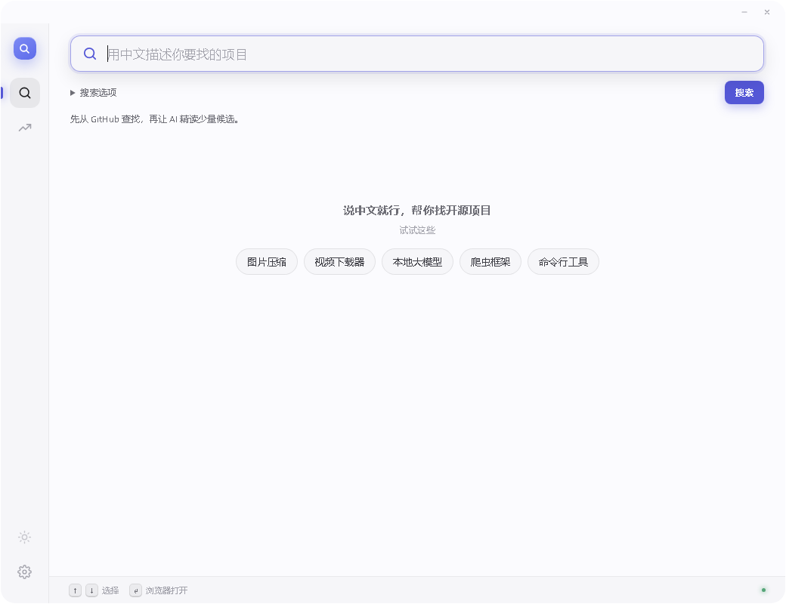

# V2.0 Alpha 3：GitHub 初筛，按需继续分析

当前开发版本 `2.0.0-alpha.3`，本地 `dev/v2.0` 分支。V1.0、V1.1 的标签与 Release 保留；Alpha 1 保留在 Git 历史中。Skills 暂停。

## 为什么调整

用户反馈 Alpha 1 对 600 个项目逐个分析，约使用 13 万输入、6 万输出 token。这是用户提供的用量，本轮未重放付费请求。Alpha 2 将 GitHub 检索范围与 AI 精读数量分开，保留中文内容，避免让扩大 GitHub 样本量直接扩大模型调用量。

## 流程

1. DeepSeek 用一次短请求提炼最多 3 路中文、3 路英文查询，用户原文始终单独保留。查询规划失败可回退原文；密钥无效/余额不足及时停止。
2. GitHub 名称/描述检索为主，按路轮流采样；另保留有限中文 README 检索，补充只在文档中出现中文的项目。只取公开仓库，不加最低 star、实现语言或归档排除条件。
3. 按仓库 ID 合并样本。初筛融合 GitHub 各路的相关性排名（RRF），保留各路领先候选；README-only 路由降低权重，非资源类需求中的 awesome 资源列表软降权。没有用 star 代替相关性。每个候选保存来源、路内排名与入选理由。
4. 默认从最多 600 个样本中选择 20 个 AI 精读候选。只为这些候选取 README，以短介绍和匹配段落组成最多 900 字节摘录，附精简元数据；每批 5 个只判断一次。未入选的 GitHub 样本仍完整保留。
5. AI 给出简短理由、相关性、类别、缺口和引文。只接受真实候选 ID；引文必须逐字存在于输入来源。没有证据的正面结论降为待确认。引用真实并不保证推理或功能已经验证。
6. 默认展示推荐项目；切换“全部 GitHub 结果”可看未送 AI、判为不符合等样本。筛选和排序位于“搜索选项”，不重复调用模型。页面不会把未分析当作无关。

## 用量边界

| AI 精读上限 | 模型调用上限（含查询规划） | 合计输出 token 上限 | 累计请求输入体积上限 |
|---|---:|---:|---:|
| 10 | 3 | 2600 | 35,000 UTF-8 字节 |
| 20（默认） | 5 | 4600 | 50,000 UTF-8 字节 |
| 30 | 7 | 6600 | 65,000 UTF-8 字节 |

输入体积按实际发送 JSON 字节数限额，**不是精确的 token 限额**。实际输入/输出 token 以 API usage 为准；在解析模型内容前计入，因此截断或无效 JSON 的已报告用量也会保留。输出上限为各次 `max_tokens` 之和，模型启用非思考模式，不自动追加付费重试。不能据此直接承诺现金成本或真实节省比例。

GitHub 范围可选 200 / 600 / 1200 / 2000，精读可选 10 / 20 / 30，二者独立。范围为上限，不保证凑满。每路最多 10 页、每页最多 100 条，每轮最多 36 次检索尝试，整个会话最多 15 分钟。GitHub token 配置后提高配额，仍共享节流和限流冷却。

输入变化、停止按钮会取消旧会话；取消在途请求不保证服务端停止计费。失败时保留 GitHub 初筛和已完成判断，不把搜索不完整表述成没有同类项目。

## 继续分析与指定项目（Alpha 3）

完成首次搜索后，结果上方会显示未完成分析的项目数和“继续分析 20 个”。此操作沿用当前 GitHub 候选及需求计划，按初筛排名选择未完成项目，不重新调用 GitHub 搜索或查询规划。数量沿用“搜索选项”中的 10 / 20 / 30；剩余不足时自动缩小。每次追加都由用户主动点击启动。

在“全部 GitHub 结果”里，未完成项目会有“分析此项目”按钮，可以直接指定初筛靠后的候选。已经有判断的项目（包括不符合、待确认）不会重复分析，也没有再次分析按钮。请求失败或取消后没有完成判断的项目仍可重试；服务端已经开始的调用可能已经计费，取消不等于退款。

| 追加操作 | 模型调用上限 | 合计输出上限 |
|---|---:|---:|
| 指定 1 个项目 | 1 | 1000 token |
| 下一批 10 个 | 2 | 2000 token |
| 下一批 20 个（默认） | 4 | 4000 token |
| 下一批 30 个 | 6 | 6000 token |

追加请求的输入体积上限仍为 `20,000 + 1500 × 本次项目数` UTF-8 字节，并非精确 token 上限。上述额度针对每次主动追加，不是整轮搜索的累计上限；连续多次点击会继续产生用量。“搜索选项”显示最近一次及当前搜索累计 API 用量，缓存打开的新一轮从零计费统计开始。

追加期间前端禁用重复按钮，后端也在发送前锁定同一会话，防止并发重复请求。停止或网络失败后保留已经完成的批次；再次继续会跳过这些项目。切换到其他需求并搜索后，旧会话按钮失效。本版续接限定于应用内当前这轮搜索，重启后还不能导入 JSON 继续。

结果写回同一搜索目录的 `latest.json`；每次追加的模型记录带 `additional-时间戳-` 前缀，保留首次和之前追加的请求/响应。目录位置在本轮搜索开始时确定，修改保存目录对新搜索生效。记录不包含请求 Authorization 凭据。

验证：本地 600 候选池连续追加依次处理第 21–40、41–60 个；指定第 600 个只发送该项目；已完成/未知 ID 不产生请求；取消在途批次后保留之前已完成的 5 个；多轮样本完整且原请求文件不被覆盖。浏览器模拟桥接验证单项目按钮、重复点击、剩余数量、停止续接和输入变化后失效。本轮没有真实 DeepSeek 付费生成，原生桌面与真实模型效果仍需试用。

## 设置与样本

- **模型**：使用 DeepSeek 官方接口，在设置填写 Key 和模型。测试连接只读取模型列表，不生成内容。模型可选项沿用 Alpha 1，服务后续变化需核实。
- **GitHub 账号**：以个人访问令牌（PAT）向 `/user` 验证后连接，显示账号名并支持断开。不是 OAuth。令牌不回显。断开不会删除外部环境变量或其他项目文件，但本应用会停止使用这些 GitHub 凭据，直到重新连接。
- **网络**：系统代理、直连、手动代理均生效，统一用于 GitHub、DeepSeek、描述翻译。手动代理支持不带账号密码的 HTTP/HTTPS 地址。测试网络使用当前表单选项，不需先保存；正式搜索使用保存的设置。
- **样本位置**：可手输绝对路径、用 Windows 原生选择器选择或打开目录；保存前检查可写性。默认 `%USERPROFILE%\Documents\GitHub Trend Finder\Samples`。
- **自动保存**：每次智能搜索建立独立 `search-*` 子目录。每批 GitHub 采样、初筛、每次精读和完成时更新 `latest.json`；模型请求/响应分别写入 `model-request-NN.json` / `model-response-NN.json`。记录包括需求、全部样本、入选标记、排名、判断、用量与警告，不包含 HTTP Authorization / API Key。README 在模型请求中只保存实际发出的摘录。只搜索 GitHub 模式使用轻量原文搜索，不走这套自动精读快照。
- **缓存**：同一需求、范围、精读数量、模型和凭据的完整无警告分析可在 30 分钟内复用；命中时本次模型用量为零，并在当前样本目录建立新快照。缓存仅在内存中，重启不恢复历史会话。历史 JSON 可手动查看，目前没有重新导入按钮。

设置存于 `%APPDATA%\com.ghfinder.desktop`。Token 和模型 Key 目前仍是本机配置文件，未接入系统凭据保险库。样本包含用户需求和公开项目资料。

## 验证

三个真实公开 GitHub 场景（固定普通中英文查询，不把仓库名写进检索词）共取 15 路、每路最多 30 个结果，再回放生产 Rust 初筛：

| 场景 | 去重样本数 | 精读候选数 | 预设锚点入选 |
|---|---:|---:|---|
| 离线 OCR | 132 | 20 | hiroi-sora/Umi-OCR |
| 局域网跨平台传文件 | 133 | 20 | localsend/localsend |
| 批量重命名 | 142 | 20 | thameera/vimv |

快照：[v2-prefilter-live-2026-11-10.json](../reports/v2-prefilter-live-2026-11-10.json)。这是有限场景的锚点召回验证，**不是全量精确率、600 个真实会话或模型检索效果评测**。仍能看到无关项目，精读判断继续负责排除噪声；其他需求的漏召回仍需积累样例。

Rust 测试覆盖中文/英文路由、0 star 项目、私有项目排除、600 选 20、预算拒绝、紧凑模型响应、虚构证据、账号验证、代理实际传输、目录保存、快照无凭据与取消。端到端模型测试使用本地模拟接口；本轮没有产生真实 DeepSeek 付费调用。

页面在隔离 Edge 1040×800 中进行截图与模拟交互检查：搜索选项、推荐/全部结果、目录选择命令、代理保存/测试、账号连接/断开均成功。后端配置和 HTTP 传输另用真实本地服务验证。Windows 原生文件夹对话框已编译，尚未进行真人点击验收；模拟桥接不等于原生 Tauri 全流程验收。

```text
python -m unittest discover -s tests -v
node --test tests/frontend.test.cjs tests/research-view.test.cjs
python tests/research-ui-smoke.py
cd src-tauri
cargo fmt --check
cargo test --locked --test core --test research_flow --test prefs_budget --test prefilter_live
cargo check --locked
```

Alpha 2 首页留档（真实布局，未填入搜索结果）：


