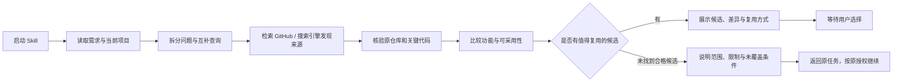
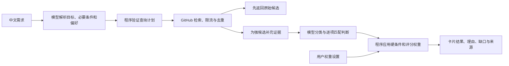

# P1 Skill 与 V2.0 升级方向

日期：2026-11-10。状态：供讨论的设计草案；P1 的候选选择暂停点已经用户确认。本文不表示 V2.0 已实现或发布。

## 两张图对应的交付

| | P1：开发前找轮子 | P2：V2.0 智能搜索 |
|---|---|---|
| 入口 | 开发助手中的 Skill | 桌面应用中的智能搜索 |
| 主要问题 | 当前构想或项目可以复用什么 | 哪些项目最满足这次搜索需求 |
| 模型 | 先使用宿主助手已有模型 | 独立配置模型服务或本地模型 |
| 额外输入 | 用户授权读取的当前项目 | 用户输入；项目目录作为以后可选模式 |
| 输出 | 候选、功能差异、复用方式、下一步选择 | 分类结果、推荐理由、可调排序 |
| 结束点 | 有候选就展示并等待用户选择 | 用户浏览、调权或打开项目 |

共用资产是需求描述、候选事实、证据与评估格式。Skill 可以先用现有工具运行，V2.0 再把这些过程变成确定的程序接口。

## P1：把项目审查放到搜索之前



原图的“当前项目审查”应在搜索前进行一次，作为基准；搜索后再比较差异。否则只能发现名称相似的项目，很难回答哪些模块能够省下开发工作。

“有类似”不等于采用整个项目。结果应区分直接使用、依赖集成、fork 改造与源码参考。所谓相似度需能解释：覆盖了哪些必要功能，形态和接口是否接近，替换现有模块会影响哪里。

“无类似”是有限搜索的结论，必须区分未找到、找到了但不适用，以及取证不足。网络失败、配额耗尽或缺少 README 都不能证明不存在同类。

用户已确认：**找到有价值候选时先展示，等用户选定后再继续**。Skill 不自动做采用决定，也不提前下载、安装或改造候选项目。

草案入口：`skills/reuse-before-build/SKILL.md`。当前放在仓库中供审阅；尚未安装为全局 Skill。它可以调用宿主已有 GitHub/检索工具，无需先开发新的搜索后端。

## P2：让模型输出可核验的特征，再由程序排序



模型负责两次不同的工作：搜索前理解需求、搜索后理解证据。检索、缓存、限流、数据验证和加权计算由程序负责。不能依靠模型“记得”某个项目就把它作为已检索到的结果。

建议保留两个可明确切换的模式：快速搜索沿用 V1.1 的术语映射和 GitHub best match；智能搜索按提交动作触发较慢的证据补全和模型分析。模型失败时保留已获得的原始结果，并展示分析未完成。

### 需求和证据

- 需求：核心用途、必要功能、平台/部署形态、许可用途限制、明确排除项、可调整偏好。
- 事实：仓库唯一 ID、原始排名、描述、topics、主语言、许可、归档、提交/Release 信息、采集时间和来源。
- 证据：短摘录、文件/页面链接、必要时的 commit；标记来自元数据、README、源码还是实测。
- 模型分析：项目类别、各功能的已满足/不满足/未知判断、适合的复用方式、原因和证据引用。

“语言”必须区分实现语言和用户界面/文档语言；“最近有 push”不自动等于维护质量；仓库主页说支持某功能不自动等于已运行验证。

分类可有一个主类别及多个标签，例如成品应用、库/框架、插件、资源集合和示例。资源集合在“直接使用”场景中可能低优先，但在学习或寻找线索时仍有价值。

### 权重只调整偏好，不放松必要条件

先判断必要条件是否已满足；明确不满足的候选不进入主推荐，未知条件展示为“待核实”。用户可以主动放宽条件，但不能仅因为 star 很高就抵消平台不符或关键功能缺失。

第一版可提供“直接使用 / 二次开发 / 实现参考”三个偏好预设，再允许修改功能匹配、改造成本、维护信号和资料完整度的权重。

示例初值（待评测，不是产品已定规则）：

```text
直接使用：功能匹配 55% + 上手/接入容易度 20% + 维护信号 15% + 资料完整度 10%
二次开发：功能匹配 45% + 改造适合度 35% + 维护信号 10% + 资料完整度 10%
```

特征分数有统一范围和含义。程序归一化用户权重；权重总和为零时恢复预设。未知特征保留未知和不确定区间，不伪装为确定的零分或满分。临时可用 GitHub 原始顺序作为稳定回退。

每个推荐展示贡献较大的因素与关键缺口，而不是只显示一个难以解释的总分。权重改变只对当前候选和已有特征重排，不再调用 GitHub 或模型。

### 限流与成本预算

以下只是第一轮验证的建议预算，需要按实测调整：一次提交产生 2–3 个互补搜索；先对去重后的元数据筛选，最多对前 5 个强候选补充 README/关键证据。初期不索引全站，也不批量克隆整个候选池。

一次搜索会话设置 GitHub 请求上限、取证上限、模型调用/输入量上限及总超时，达到上限返回已有结果并说明覆盖不足。预算不足时，应缩小这一轮候选取证范围，不能把“未知”改为“已满足”。

所有 GitHub 请求共用凭据范围内的队列，遵循实际响应中的限流与冷却信号；取消待执行旧查询不会退还已经发出的请求。网页发现来源不能成为规避限流的手段。

缓存分开管理：原始检索结果、按 commit/内容摘要标识的证据，以及包含需求摘要、模型版本、提示模板版本的分析结果。缓存需隔离凭据/数据可见范围。调权不会使分析缓存失效。

## 与当前代码衔接

| 当前模块 | V2.0 中的用途与缺口 |
|---|---|
| `lexicon.py` / `src-tauri/src/lexicon.rs` | 保留为快速模式、模型失败回退及术语提示，不再承担所有自然语言约束解析 |
| `src-tauri/src/lib.rs` 的 `github_items` | 复用共享限流、凭据缓存和请求过期控制；先拆成可由应用和 CLI 调用的核心层 |
| `Item` / `SearchResponse` | 当前信息不足以证明平台/Release/许可等条件；逐步增加事实、证据与分析状态 |
| `remote.py` / `cli.py` | 保留实验和基线用途；当前没有项目调研 JSON 协议，也没有多查询会话预算 |
| `search.py` | 保持离线实验与基线，不把原有手工加权方案直接宣布为 V2.0 推荐算法 |
| `dist/index.html` | 增加快速/智能入口、分析进度、类别、证据展开和调权；卡片外观后续单独讨论 |

特别注意：模型已经生成的英文查询或 GitHub 限定符，不能再通过现有 `remote.build()` / 词库扫描一遍，否则符号和筛选语义可能丢失。新增查询计划应有独立的、经程序验证的检索入口。

建议长期把 Rust 搜索核心同时提供给 Tauri 和一个 JSON CLI，供 Skill 选用。当前阶段只统一协议，不假设不存在的 `research` 命令已经可调用，也不要求 Skill 必须等待这个 CLI 才能使用。

## 评测与推进顺序

项目已有盲评中，英文 GitHub 基线相关性 7.20，高于当时自研排序 6.40。评审主要根据仓库名和 star，存在知名项目偏差，因此它既是保留基线的理由，也不足以证明“所有重排都无价值”。新方案要检验增加证据后是否改善真实任务。

1. **先试 P1**：用一个真实开发构想和一个现有项目，人工检查候选是否省下工作、差异是否真实、能否帮助作出采用决定。
2. **补证据协议**：固定需求与候选快照，让 Skill 与桌面实验使用同一份输入，避免每次候选变化影响比较。
3. **验证智能查询**：在固定需求集上比较 V1.1 与模型提炼查询的召回和硬约束保持情况。
4. **验证分类和排序**：用同一候选池对比 GitHub 原始顺序、分类不重排、模型特征加权；使用对称的 README/功能证据盲评。
5. **接入 V2.0 UI**：只有实测更好时才设为推荐模式；保留原始顺序开关。

记录前五条结果的适用比例、硬约束违规数、用户找到可用项目的时间、证据是否支持结论、延迟与每次调用成本。原有 51 条词库查询继续作技术回归；另外建立包含真实约束的独立任务集，调权用的样本与最终评测样本分开。

## 版本与本轮范围

P1 Skill 和 P2 应用分别交付、分别标版本。V1.0 / V1.1 的现有标签和 Release 保留。V2.0 使用独立开发分支；应用尚未实现前不把 Cargo/Tauri 版本号改为 2.0，不移动旧标签。

本轮交付是 Skill 草案、升级方向与行为验收场景；尚未安装全局 Skill、接入新模型或发布 V2.0。下一步适合先按 P1 跑一次真实调研，确认报告是否足够支撑你的选择。
